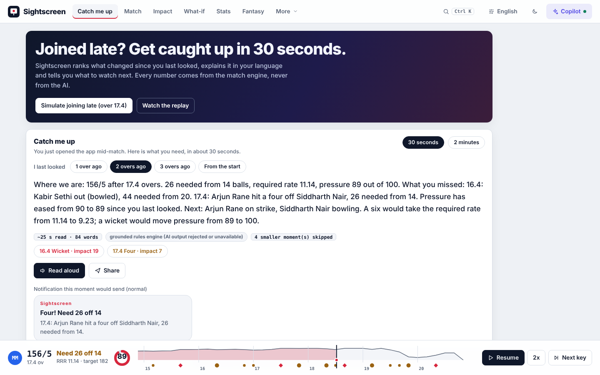
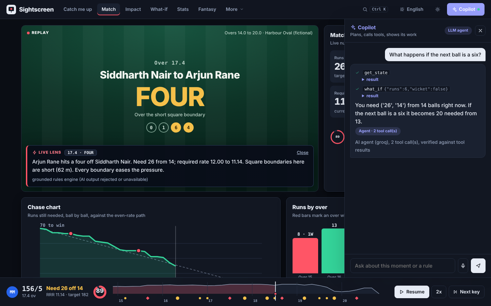
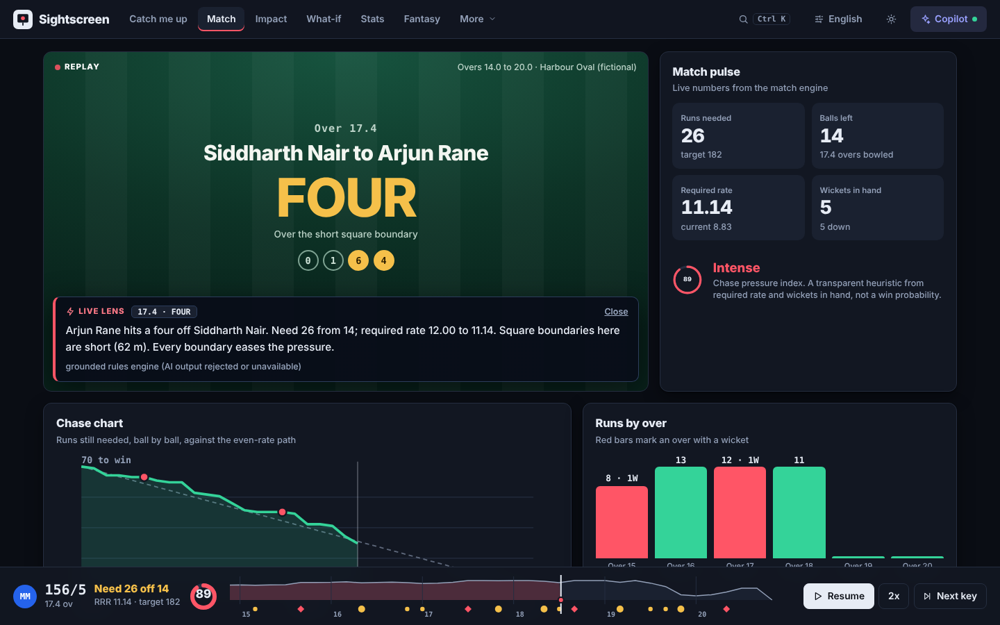

# Sightscreen - joined the match late? Get caught up in 30 seconds



**Sightscreen** is an AI cricket companion built around one idea: the fan who opens the app mid-match needs to know where the chase stands, what they missed and what to watch next. It ranks what changed since they last looked and explains it in English, Hinglish or Hindi in about 30 seconds. Every number is computed by code; AI only helps with wording and answers, behind verification. (The name was chosen for this demo; check trademark and domain availability before public use.)

## What is new in this version
- **New name and a new interface.** Top navigation, a persistent match timeline dock with event lanes (pressure curve, wickets, boundaries, over markers; scrub it with mouse, touch or arrow keys), a command palette (Ctrl or Cmd + K), daylight and floodlight themes, a ground map drawn to scale, and a Copilot drawer.
- **Deeper AI.**
  - *Retrieval with citations:* BM25 search over a cricket-rules and how-it-works knowledge base; answers cite their passages.
  - *Tool-calling agent:* the LLM plans which read-only tools to call (JSON protocol, max 4 steps), and its steps stream live to the screen.
  - *Verification:* numbers must appear in tool results, citations must be real, banned claims are rejected; otherwise the deterministic router answers and says why.
  - *Evaluation:* LLM-as-judge faithfulness, retrieval metrics (recall@1 94%, recall@3 100%), red-team suite, 222-briefing sweep.
  - *Production tooling:* every AI run is traced (per-step latency, outcome codes, prompt version) on the Operations page; an offline agent safety regression suite replays 10 recorded model outputs through the real verifier; optional `ADMIN_TOKEN` protects operations and evaluation pages; security headers including a Content-Security-Policy.
  Details: [docs/AI_ARCHITECTURE.md](docs/AI_ARCHITECTURE.md).


*The agent screenshot was captured with a scripted stand-in model, not a real LLM. Behaviour with a real model is untested.*



## Everything included
Catch me up (lead feature, shareable mobile card at `/?catchup=22&lang=hinglish`, push payload endpoint) - Live Lens with Hinglish/Hindi and voice - Impact replay - What-if lab - Stats with ground map - Fantasy pulse - Support copilot (points ledger, scorer corrections, resolve-or-escalate, deflection evaluation) - Operations (messy two-vendor feed repaired and reconciled, latency and AI guard metrics) - AI quality.
Lead feature deep dive: [docs/LEAD_FEATURE_CATCHUP.md](docs/LEAD_FEATURE_CATCHUP.md). Case study and Q&A: [docs/FDE_CASE_STUDY.md](docs/FDE_CASE_STUDY.md).

> **Data honesty:** fictional teams, players and venue; simulated replay. No official live scores, fantasy points or betting advice.

## Run
```bash
cd backend && python -m venv .venv && source .venv/bin/activate   # Windows: .venv\Scripts\Activate.ps1
pip install -r requirements.txt && GROQ_API_KEY=your-key python -m uvicorn app.main:app --reload --port 8000
cd frontend && npm install && npm run dev       # http://localhost:5173
```
Tests: `cd backend && python -m pytest -q` (57 tests). Deploy and GitHub steps: [docs/SETUP_AND_DEPLOY.md](docs/SETUP_AND_DEPLOY.md). Operations: [docs/RUNBOOK.md](docs/RUNBOOK.md). Load test: `python scripts/loadtest.py <url>`.
Stack: React 18, TypeScript, Vite; FastAPI, Pydantic, SQLite; Groq (Llama), Gemini, Anthropic or OpenAI; pytest; Docker, GitHub Actions, Render.

---
## Earlier notes (still accurate)
## Design principles
- **The engine owns every number; AI only explains.** A grounding guard (including Devanagari digits) rejects any model output containing a number that is not in the verified facts, then shows the deterministic explanation.
- **Event-sourced.** Deliveries are stored ball by ball in SQLite; all state is replayed from them, so every feature agrees.
- **Measured, not assumed.** `/api/matches/{id}/eval/lens` and `/eval/redteam` run the evaluations; rate-limited to protect the key.
- **Works without AI.** With no key it falls back to localised rules-engine text; with a free Groq or Gemini key the LLM writes the language.

## Run
```bash
cd backend && python -m venv .venv && source .venv/bin/activate   # Windows: .venv\Scripts\Activate.ps1
pip install -r requirements.txt && GROQ_API_KEY=your-key python -m uvicorn app.main:app --reload --port 8000
cd frontend && npm install && npm run dev       # http://localhost:5173
```
Tests: `cd backend && python -m pytest -q` (40 tests). Deploy and GitHub steps: [docs/SETUP_AND_DEPLOY.md](docs/SETUP_AND_DEPLOY.md). Demo script: [docs/DEMO_V3.md](docs/DEMO_V3.md). Operations: [docs/RUNBOOK.md](docs/RUNBOOK.md). FDE rollout thinking: [docs/FDE_ENGAGEMENT.md](docs/FDE_ENGAGEMENT.md). Load test: `python scripts/loadtest.py <url>`.

Stack: React 18, TypeScript, Vite; FastAPI, Pydantic, SQLite; Groq (Llama 3.1) or Gemini; pytest; Docker, GitHub Actions, Render.
